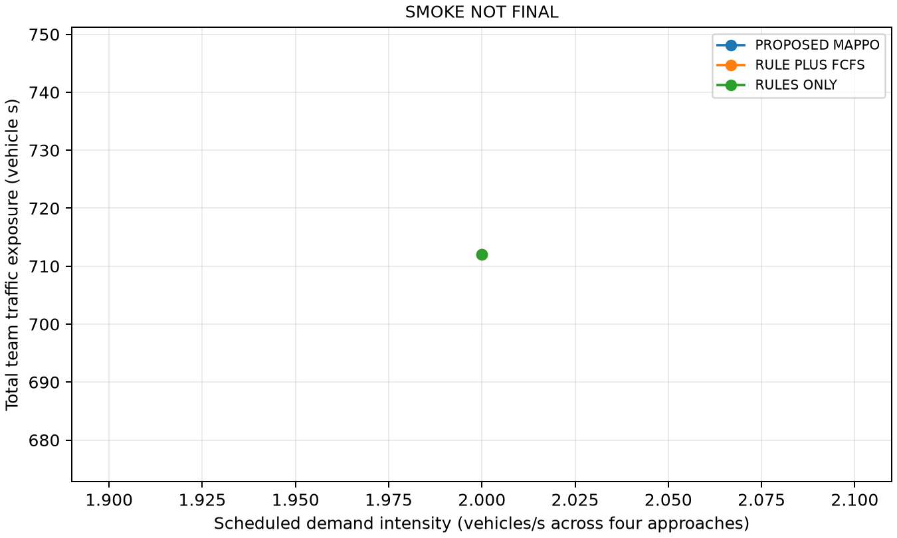
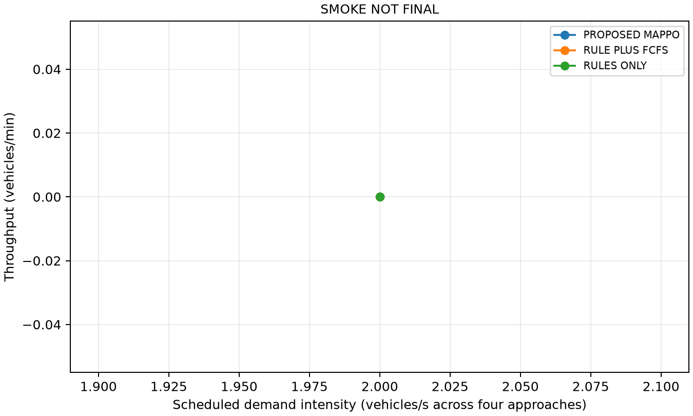
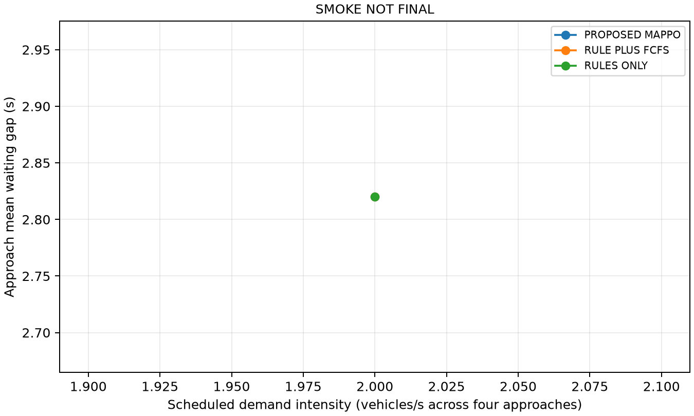
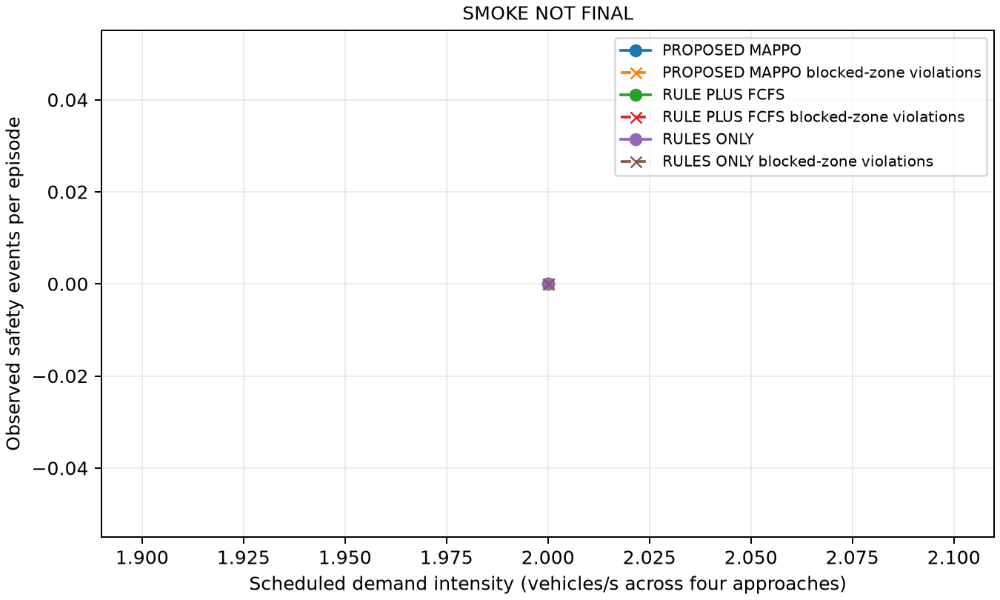

# Final quantitative evaluation

**SMOKE_NOT_FINAL**

One unsignalized four-way intersection; AV-only; one incoming lane/approach; 12 legal movements; ideal same-step V2V; <=4 queue-head negotiators.

0 collisions observed in 9 evaluation episodes. Unsafe episode rate: 0.000.

**Safety:** 9/9 collision-free episodes; 0 blocked-zone violations

**Efficiency:** Proposed episode averages: TTT 333.413 vehicle s; travel 47.720 s; throughput 2.350 veh/min

**Fairness:** Proposed episode averages: wait 22.178 s; max 24.080 s; p95 23.952 s; approach gap 3.610 s; inversion 0.667

**Scalability:** Proposed episode averages: completion 0.667; max live 4.667; max negotiators 3.333

**Architecture:** Ego-local: True; critic calls: 0; unchanged policy: True

| Scenario | Method | n | Classifications | TTT (vehicle s) | Travel mean (s) | Throughput (veh/min) | Completion | Wait mean (s) | Wait p95 (s) | Wait max (s) | Approach gap (s) | FCFS inversion rate | Max live | Max negotiators |
| --- | --- | --- | --- | --- | --- | --- | --- | --- | --- | --- | --- | --- | --- | --- |
| rule_resolved_two | PROPOSED_MAPPO | 1.000 | {'PASS': 1} | 93.520 | 46.760 | 2.459 | 1.000 | 0.000 | 0.000 | 0.000 | N/A | 1.000 | 2.000 | 2.000 |
| rule_resolved_two | RULE_PLUS_FCFS | 1.000 | {'PASS': 1} | 93.520 | 46.760 | 2.459 | 1.000 | 0.000 | 0.000 | 0.000 | N/A | 1.000 | 2.000 | 2.000 |
| rule_resolved_two | RULES_ONLY | 1.000 | {'PASS': 1} | 93.520 | 46.760 | 2.459 | 1.000 | 0.000 | 0.000 | 0.000 | N/A | 1.000 | 2.000 | 2.000 |
| regulatory_cycle | PROPOSED_MAPPO | 1.000 | {'PASS': 1} | 194.720 | 48.680 | 4.591 | 1.000 | 1.680 | 4.016 | 4.400 | 4.400 | 0.333 | 4.000 | 4.000 |
| regulatory_cycle | RULE_PLUS_FCFS | 1.000 | {'PASS': 1} | 195.720 | 48.930 | 4.491 | 1.000 | 2.030 | 5.330 | 5.960 | 5.960 | 0.333 | 4.000 | 4.000 |
| regulatory_cycle | RULES_ONLY | 1.000 | {'SAFE_DEGRADATION': 1} | 360.000 | N/A | 0.000 | 0.000 | 67.830 | 67.840 | 67.840 | 0.040 | N/A | 4.000 | 4.000 |
| normal | PROPOSED_MAPPO | 1.000 | {'SAFE_DEGRADATION': 1} | 712.000 | N/A | 0.000 | 0.000 | 64.855 | 67.840 | 67.840 | 2.820 | N/A | 8.000 | 4.000 |
| normal | RULE_PLUS_FCFS | 1.000 | {'SAFE_DEGRADATION': 1} | 712.000 | N/A | 0.000 | 0.000 | 64.855 | 67.840 | 67.840 | 2.820 | N/A | 8.000 | 4.000 |
| normal | RULES_ONLY | 1.000 | {'SAFE_DEGRADATION': 1} | 712.000 | N/A | 0.000 | 0.000 | 64.855 | 67.840 | 67.840 | 2.820 | N/A | 8.000 | 4.000 |

TTT includes scheduled waiting before insertion and unfinished demand censored at the frozen budget. Completed-trip summaries use scheduled demand to network exit; unfinished trips are excluded and completion is shown alongside. Waiting includes only speed below the existing 0.5 m/s threshold on the incoming lane, including followers; unfinished waits are observed lower bounds. FCFS uses incoming-lane entry and front-bumper incoming-lane exit; timestamp ties use vehicle ID consistently; only geometrically conflicting different-approach pairs with both service times are eligible. No arbitrary fairness score. Lower waiting gap is more equal across approaches. HARDWARE-DEPENDENT RUNTIME MEASUREMENTS: full joint semantic inference and each ego decision plus native constraint calculation; no universal real-time claim. Braking events are contiguous episodes of measured deceleration exceeding configured comfortable deceleration; emergency-stop API counts are separate. 95% CIs use deterministic percentile bootstrap of means (2000 resamples, seed 260826); n=1 has no CI. Invalid experiments remain visible and are excluded from performance aggregation. Paired percentages with a zero baseline are N/A; positive TTT/wait differences are worse, positive throughput/completion are better. Smoke is plumbing evidence only. All results are bounded simulation evidence, not real-world validation; inD is intention-model provenance.

## Every episode and replay

| Run | Method | Scenario | Seed | Classification | Error | Replay command |
| --- | --- | --- | --- | --- | --- | --- |
| 20261006T155632429088Z_1274a41f | PROPOSED_MAPPO | rule_resolved_two | N/A | PASS | N/A | & "C:\R26-DS-017\venv\Scripts\python.exe" -B run_final_evaluation.py --replay 20261006T155632429088Z_1274a41f --gui |
| 20261006T155638774962Z_b0e185b6 | RULE_PLUS_FCFS | rule_resolved_two | N/A | PASS | N/A | & "C:\R26-DS-017\venv\Scripts\python.exe" -B run_final_evaluation.py --replay 20261006T155638774962Z_b0e185b6 --gui |
| 20261006T155645262916Z_1b8bf96e | RULES_ONLY | rule_resolved_two | N/A | PASS | N/A | & "C:\R26-DS-017\venv\Scripts\python.exe" -B run_final_evaluation.py --replay 20261006T155645262916Z_1b8bf96e --gui |
| 20261006T155652173105Z_aa598d64 | PROPOSED_MAPPO | regulatory_cycle | N/A | PASS | N/A | & "C:\R26-DS-017\venv\Scripts\python.exe" -B run_final_evaluation.py --replay 20261006T155652173105Z_aa598d64 --gui |
| 20261006T155706754305Z_85d90c10 | RULE_PLUS_FCFS | regulatory_cycle | N/A | PASS | N/A | & "C:\R26-DS-017\venv\Scripts\python.exe" -B run_final_evaluation.py --replay 20261006T155706754305Z_85d90c10 --gui |
| 20261006T155722766240Z_28f646e3 | RULES_ONLY | regulatory_cycle | N/A | SAFE_DEGRADATION | N/A | & "C:\R26-DS-017\venv\Scripts\python.exe" -B run_final_evaluation.py --replay 20261006T155722766240Z_28f646e3 --gui |
| 20261006T155816368750Z_73b24841 | PROPOSED_MAPPO | normal | 101.000 | SAFE_DEGRADATION | N/A | & "C:\R26-DS-017\venv\Scripts\python.exe" -B run_final_evaluation.py --replay 20261006T155816368750Z_73b24841 --gui |
| 20261006T155939628131Z_2ee39d4d | RULE_PLUS_FCFS | normal | 101.000 | SAFE_DEGRADATION | N/A | & "C:\R26-DS-017\venv\Scripts\python.exe" -B run_final_evaluation.py --replay 20261006T155939628131Z_2ee39d4d --gui |
| 20261006T160104274413Z_1ea91d06 | RULES_ONLY | normal | 101.000 | SAFE_DEGRADATION | N/A | & "C:\R26-DS-017\venv\Scripts\python.exe" -B run_final_evaluation.py --replay 20261006T160104274413Z_1ea91d06 --gui |

## Controlled message faults

| Fault | Permission | Attempted entry rejected | Passed |
| --- | --- | --- | --- |
| missing_required_coordination | SAFE_HOLD | 1.000 | 1.000 |
| stale_coordination | SAFE_HOLD | 1.000 | 1.000 |
| missing_clearance | SAFE_HOLD | 1.000 | 1.000 |
| stale_clearance | SAFE_HOLD | 1.000 | 1.000 |

